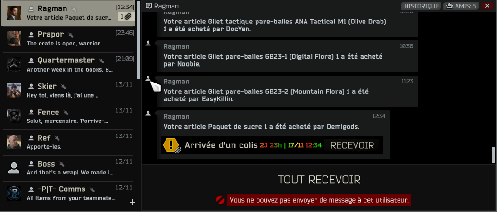
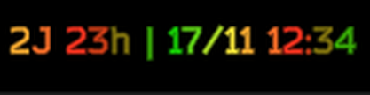

# ⏳ World Mail Countdown 1.2.0

**Never lose your gear in the mail again.** A BepInEx plugin for SPT 4.1.x that adds a **live, color-coded countdown** to every mail with items: refunds, insurance returns, quest rewards, trader packages, flea market payments… Fully configurable in F12, 16 languages.

  

## ✨ Features
- ⏱️ **Live countdown** next to every message with attachments, colored by time left.

  

- 🎨 **8 color tiers**: for each one, the time left it starts at, any color, rainbow and/or blinking.
  Default: > 1 week cyan, > 3 days green, > 1 day lime, > 6 h yellow, > 1 h orange, > 10 min red, > 1 min blinking magenta, last minute rainbow.
- 🌈 **20 color themes** (Traffic light, Neon, Fire, Ocean, Matrix, Cyberpunk, Gold…), smooth gradient between tiers, rainbow per letter or per word.
- 🔤 **8 display styles**: `3D 23:35:46`, `3D 23h 35m 46s`, `3D 23h`, `~3D`, `3 days 23 h 35 min`, `95:35:46`, `95h 35m`, `3.9D`.
- 📅 **Expiry date in your local time** (optional): `2D 23h | 17/11 12:34`.
- 🔣 **88 bracket styles** `( )` `[ ]` `« »` `•`… or your own text.
- ✂️ **Max length**: long text is shortened step by step so it never goes under the RECEIVE button.
- 🌍 **16 languages**: time units and day letter follow your language (D, J, T, d…).
- 🪶 **Lightweight**: one small DLL, no game files changed on disk.

## 🔔 Pair it with World Mail Alerts 2.0
Want a **sound and a notification** before a mail expires, your **flea market sales with price**, a **history window** and a **daily money graph**?
➡️ **[World Mail Alerts](https://sp-mod.com/mod/3361/world-mail-alerts-history-money-graph-add-16-translations)** ([GitHub](https://github.com/PraED-lab/WorldMailAlerts)). Each mod works on its own, and they work great together.

## 🌍 Languages
Français, English, Deutsch, Español, Português, Italiano, Polski, Русский, Čeština, Slovenčina, Türkçe, Magyar, Română, 中文, 日本語, 한국어. **Auto** follows the game language.

## 📥 Installation
1. Close the game.
2. Download `WorldMailCountdown` from the **Releases** section or from the [Forge](https://sp-mod.com/mod/3310/world-mail-countdown-add-16-translations).
3. Copy `BepInEx/plugins/WorldMailCountdown.dll` into your SPT `BepInEx/plugins` folder.

**Updating from MailCountdown 1.1.x:** delete the old `MailCountdown.dll` first. Never keep both.

## ⚙️ Settings
Press **F12** in game → **World Mail Countdown** (BepInEx ConfigurationManager).
Without ConfigurationManager, edit `BepInEx/config/praedlab.mailcountdown.cfg` (created at first launch).

## ✅ Compatibility
- **SPT 4.1.x** with BepInEx 5. No other mod required.
- The mod changes how mail text is displayed, so it may conflict with another mod that edits the same text. Please report any conflict.

## 🛠️ Troubleshooting
- Text overlaps the RECEIVE button? Lower **Max length**.
- Bug report: turn on **Debug layout log**, then open an **issue** with your `BepInEx/LogOutput.log`.

## 📝 Changelog
### 1.2.0
- Renamed **World Mail Countdown**. F12 settings menu.
- 8 color tiers with custom times, colors, rainbow and blinking. 20 themes, smooth gradient.
- 16 languages with translated time units. 8 display styles, 88 bracket styles.
- Optional expiry date in your local time. Automatic max length.

### 1.1.1
- Live countdown on mails with attachments, days + time, follows the game language (D / J).

## 👤 Author
**PraED_TV** (PraED-lab) · Discord: **PraED_tv** · MIT license. Not affiliated with Battlestate Games.

---

## 🇫🇷 En français
**World Mail Countdown** ajoute un **compte à rebours en couleur** sur chaque courrier avec objets, pour ne plus jamais perdre un colis. 8 paliers de couleurs, 20 thèmes, 8 styles d'affichage, date d'expiration à ton heure locale, 16 langues, tout se règle dans **F12**.
À associer avec **[World Mail Alerts 2.0](https://sp-mod.com/mod/3361/world-mail-alerts-history-money-graph-add-16-translations)** pour les alertes sonores, les ventes au marché, l'historique et le graphique de la journée. Chaque mod fonctionne seul, et les deux se complètent.
